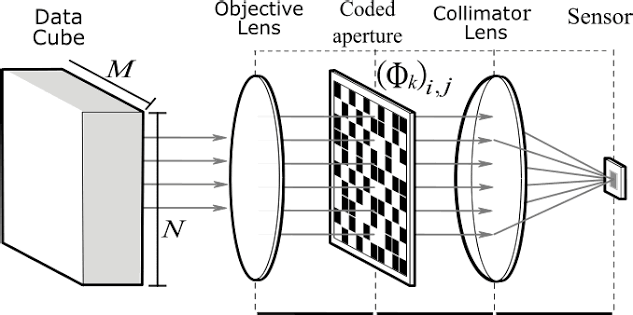
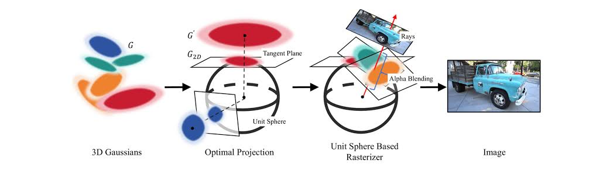
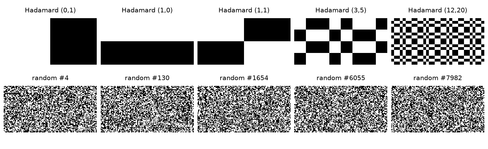
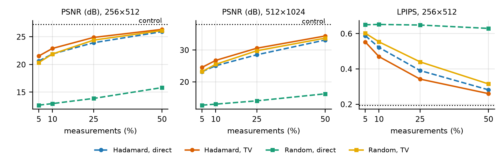
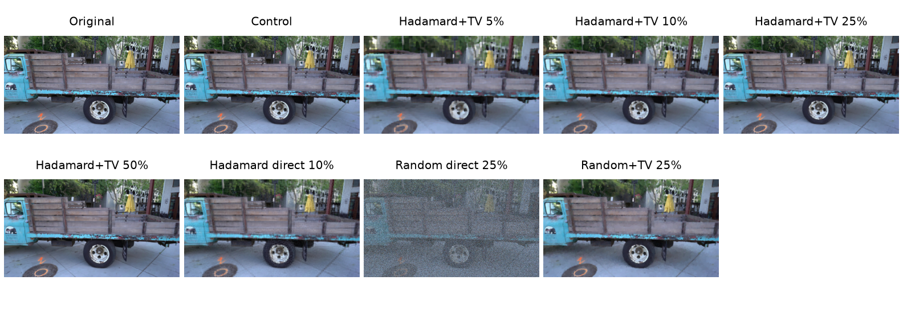
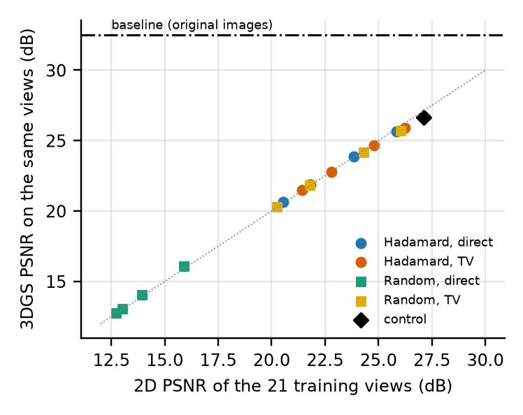
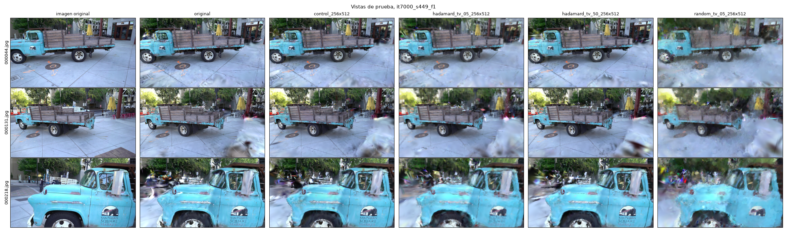

##  {.hero-slide}

:::::::: title-hero
::: eyebrow
INF449 · Fotografía Computacional · Proyecto final
:::

::: hero-paper
¿Cuántas mediciones necesita una cámara de un píxel?\
De la reconstrucción 2D a 3D Gaussian Splatting
:::

::: hero-authors
Francisco Alfaro · Ayrton Perez
:::

::: hero-meta
Universidad Técnica Federico Santa María, Valparaíso, Chile

Escena Truck (Tanks and Temples) · código: github.com/fralfaro/spc-gs
:::

::: hero-presenter
Presentan: **Francisco Alfaro** y **Ayrton Perez**
:::
::::::::

::: notes
Presento el proyecto final: una cámara de un píxel simulada sobre las vistas de la escena Truck, y qué le pasa a la calidad, primero en 2D y luego en un modelo 3D con Gaussian Splatting, cuando se reduce el número de mediciones. Voy a dejar claro el objetivo, las hipótesis y qué resultados las confirman.
:::

## Medir menos ahorra tiempo, pero ¿cuánta calidad se pierde?

::: eyebrow
Problema y objetivo
:::

:::::: problem-text
::: fragment
[Problema]{.kicker}

Una cámara de un píxel (SPC) cambia el sensor matricial por **un detector** y una secuencia de patrones: sensor más simple, pero **más mediciones por imagen**.
:::

::: fragment
[Brecha]{.kicker}

Una escena 3D necesita **decenas o cientos de vistas**. Cada medición ahorrada por vista acorta la captura, pero **no se sabe cuánto daña** al modelo 3D.
:::

::: fragment
[Objetivo]{.kicker}

Medir cuánta calidad se pierde en las vistas 2D y en un modelo **3D Gaussian Splatting** al tomar **5, 10, 25 y 50 %** de las mediciones.
:::
::::::

```{=html}
<div class="flow-strip">
  <div class="flow-node"><b>Escena</b><span>24 vistas de Truck</span></div>
  <div class="flow-arrow">→</div>
  <div class="flow-node"><b>Cámara de un píxel</b><span>simulada, r = 5 – 50 %</span></div>
  <div class="flow-arrow">→</div>
  <div class="flow-node"><b>Vistas 2D</b><span>directa o TV</span></div>
  <div class="flow-arrow">→</div>
  <div class="flow-node"><b>3D Gaussian Splatting</b><span>21 vistas de entrenamiento</span></div>
</div>
```

::: notes
El problema es de costo: la cámara de un píxel es barata en el sensor, pero cada imagen exige una secuencia de mediciones. Ese costo se multiplica en 3D, porque 3DGS necesita muchas vistas. La brecha es que no está cuantificado cuánto de la pérdida 2D llega al modelo 3D. El objetivo es medirlo de forma controlada.
:::

## Cámara de un píxel: la calidad depende de las mediciones

::: eyebrow
Antecedentes · Cámara de un píxel (SPC)
:::

::::: fig-text
:::: {.image-frame}
{fig-alt="Esquema de una cámara de un píxel: cubo de datos, lente objetivo, apertura codificada con el patrón Φk, lente colimadora y sensor de un solo píxel."}

::: image-caption
Esquema de una cámara de un píxel: la luz pasa por un patrón y un lente la concentra en un solo sensor.
:::
::::

::: points
**1. Un patrón** $\Phi_k$ (DMD) sobre la escena; **un fotodetector** suma la luz: un número $y_k$.

**2. Se repite con K patrones** y se reconstruye la imagen.

**3. Todo depende de K:** con 50 mediciones la imagen es una mancha (**≈ 10 dB**); con 2500, **27 a 34 dB**.
:::
:::::

::: notes
Esta es la idea física. En vez de un sensor con millones de píxeles, hay un único detector. Delante se coloca un patrón, por ejemplo en un DMD. Cada patrón da una sola medición, la suma de la luz que deja pasar. Repitiendo con muchos patrones se obtiene un vector de mediciones, y de ahí se reconstruye la imagen. Esto simplifica el sensor, pero cuesta más mediciones por imagen.
:::

## 3DGS: escena como gaussianas 3D, entrenada con fotos

::: eyebrow
Antecedentes · 3D Gaussian Splatting (3DGS)
:::

::::: {.image-frame .wide-fig}
{fig-alt="Gaussianas 3D, proyección al plano de la imagen, rasterizador con mezcla alfa e imagen final de un camión."}
:::::

::::: {.points .points-row}
::: fragment
- **La escena es una nube de gaussianas 3D**: elipsoides con posición, forma, color y opacidad.
- **Renderizar = proyectar a 2D y mezclar** (*alpha blending*), diferenciable.
:::

::: fragment
 Se entrena minimizando $(1-\lambda)\mathcal{L}_1+\lambda\mathcal{L}_{\text{D-SSIM}}$ contra las fotos: aquí, **imágenes reconstruidas** con pocas mediciones.
:::
:::::

::: notes
3DGS no usa una malla ni una red densa: representa la escena como una nube de gaussianas 3D, cada una con posición, forma, color y opacidad. Para generar una imagen desde una cámara, cada gaussiana se proyecta al plano de la imagen y se mezclan de adelante hacia atrás con alpha blending. Todo el proceso es diferenciable, y eso permite entrenarlo con imágenes.
:::

## Hipótesis

::: eyebrow
Lo que esperábamos encontrar
:::

```{=html}
<div class="hyp-grid">
  <div class="hyp-card"><span class="hyp-id">H1</span><p><strong>La calidad 2D cae de forma monótona</strong> al reducir las mediciones, y la <strong>rejilla</strong> fija el techo.</p></div>
  <div class="hyp-card"><span class="hyp-id">H2</span><p><strong>La TV mejora a la reconstrucción directa</strong>, y es imprescindible con patrones aleatorios.</p></div>
  <div class="hyp-card"><span class="hyp-id">H3</span><p><strong>Hadamard</strong> iguala o supera a otros órdenes; el aleatorio con TV <strong>se acerca a razones altas</strong>.</p></div>
  <div class="hyp-card"><span class="hyp-id">H4</span><p><strong>3DGS hereda la degradación 2D</strong> en las vistas con que se entrena: ni la corrige ni la amplifica.</p></div>
  <div class="hyp-card"><span class="hyp-id">H5</span><p>Con <strong>pocas vistas de prueba</strong> el PSNR 3D no discrimina; con <strong>muchas vistas reservadas</strong> sí, y las condiciones buenas igualan al baseline.</p></div>
</div>
```

::: notes
Planteamos cinco hipótesis antes de ver los resultados finales. H1 y H2 son de 2D. H3 compara patrones. H4 y H5 son del paso a 3D: H4 dice que el modelo hereda el error de sus imágenes de entrada, y H5 dice que la evaluación con tres vistas de prueba es poco sensible. Al final volvemos a esta lámina con el veredicto de cada una.
:::

## Medición y reconstrucción

::: eyebrow
Fundamentos · Medición y reconstrucción
:::

:::::: eq-row
::: equation-card
[Medición con K patrones, razón r = K/N]{.eq-label}

$$\mathbf{y}=\mathbf{\Phi}\mathbf{x}+\mathbf{n},\qquad r=\tfrac{K}{N}$$

[Directa: mínima norma]{.eq-label}

$$\hat{\mathbf{x}}=\mathbf{\Phi}^{\top}\mathbf{y}$$

[Variación total (TV), con FISTA]{.eq-label}

$$\hat{\mathbf{x}}=\arg\min_{\mathbf{x}}\ \tfrac12\|\mathbf{\Phi}\mathbf{x}-\mathbf{y}\|_2^2+\lambda\,\mathrm{TV}(\mathbf{x})$$
:::

::: points
Cada patrón da **un número** $y_k$. Las filas de $\mathbf{\Phi}$ son ortonormales y separables: se aplican con transformadas rápidas.

**Directa:** instantánea, rellena con ceros lo no medido.

**TV:** supone **bordes nítidos y zonas suaves**. 100 iteraciones, $\lambda=0.003$.
:::
::::::

::: notes
Cada patrón produce un producto interno entre patrón y escena. Con K patrones se obtiene el vector y. La reconstrucción directa es la solución de mínima norma; la TV agrega el a priori de poca variación total y se resuelve con FISTA y el proximal de Chambolle, con lambda 0,003 elegido en una vista aparte.
:::

## Patrones: Hadamard, aleatorio y DCT

::: eyebrow
Fundamentos · Patrones
:::

::::: fig-row
:::: {.image-frame}
{fig-alt="Cinco patrones de Hadamard de frecuencia creciente (arriba) y cinco patrones binarios aleatorios (abajo)."}

::: image-caption
Hadamard por secuencia (arriba) y aleatorio binario (abajo).
:::
::::
:::::

::::: {.points .points-row}
::: fragment
- **Hadamard:** binario -1 o +1, en este caso, se miden primero las **bajas frecuencias**.
- **Aleatorio:** Hadamard con píxeles permutados; siempre se mide el nivel medio (DC).
:::

::: fragment
- **DCT:** referencia no binaria. Un DMD real solo muestra 0/1, así que ±1 se obtiene con dos patrones complementarios.
:::
:::::

::: notes
Hadamard es la base binaria clásica; la ordenamos por frecuencia y medimos primero las bajas. El aleatorio es un Hadamard con los píxeles permutados y un subconjunto elegido al azar; siempre medimos el patrón constante, porque sin él el nivel medio queda indeterminado. La DCT es solo una referencia no binaria.
:::

## Flujo experimental: todo se compara con el original

::: eyebrow
Metodología
:::

```{=html}
<div class="pipe-row">
  <div class="pipe-step"><b>1</b><strong>Vista original</strong><span>979 × 546</span></div>
  <div class="flow-arrow">→</div>
  <div class="pipe-step"><b>2</b><strong>Remuestreo a la rejilla</strong><span>256 × 512 o 512 × 1024</span></div>
  <div class="flow-arrow">→</div>
  <div class="pipe-step"><b>3</b><strong>Medir y reconstruir</strong><span>patrón × método × razón</span></div>
  <div class="flow-arrow">→</div>
  <div class="pipe-step"><b>4</b><strong>Volver a 979 × 546</strong><span>JPEG calidad 100</span></div>
</div>
<div class="pipe-row">
  <div class="pipe-step alt"><b>5</b><strong>Entrenar 3DGS</strong><span>21 vistas, gsplat</span></div>
  <div class="flow-arrow">→</div>
  <div class="pipe-step alt"><b>6</b><strong>Renderizar</strong><span>3 + 230 + 21 vistas</span></div>
  <div class="flow-arrow">→</div>
  <div class="pipe-step alt"><b>7</b><strong>Comparar con el original</strong><span>PSNR, SSIM, LPIPS</span></div>
</div>
<div class="points"><p><strong>Datos:</strong> escena Truck, 24 vistas (21 entrenan, 3 prueba, 230 reservadas), rejillas 256 × 512 y 512 × 1024, gsplat, RTX 4060 8 GB. <strong>Control:</strong> sin cámara. <strong>Baseline:</strong> 3DGS con originales.</p></div>
```

::: notes
Este es el flujo completo. Una vista original se remuestrea a la rejilla, se mide con la cámara simulada, se reconstruye y se devuelve al tamaño original. Con esas imágenes se entrena 3DGS usando las mismas cámaras COLMAP del original, y se renderiza para comparar siempre contra la imagen original. El control salta la cámara y el baseline salta todo el bloque de la cámara.
:::

## 2D: con TV, medir el 50 % cuesta menos de 1 dB

::: eyebrow
Resultados 2D · PSNR (dB), 24 vistas
:::

```{=html}
<table class="table-roomy" aria-label="PSNR 2D por patrón, método y razón en las dos rejillas">
<thead>
<tr><th rowspan="2">Patrón · método</th><th colspan="4" class="group-start">Rejilla 256 × 512</th><th colspan="4" class="group-start">Rejilla 512 × 1024</th></tr>
<tr><th class="group-start">5 %</th><th>10 %</th><th>25 %</th><th>50 %</th><th class="group-start">5 %</th><th>10 %</th><th>25 %</th><th>50 %</th></tr>
</thead>
<tbody>
<tr><td>Hadamard · directa</td><td class="group-start">20,63</td><td>21,89</td><td>23,92</td><td>25,92</td><td class="group-start">23,17</td><td>25,04</td><td>28,48</td><td>33,12</td></tr>
<tr class="ours"><td>Hadamard · TV</td><td class="group-start">21,52</td><td>22,89</td><td>24,87</td><td>26,33</td><td class="group-start">24,54</td><td>26,72</td><td>30,54</td><td>34,39</td></tr>
<tr><td>Aleatorio · directa</td><td class="group-start">12,65</td><td>12,93</td><td>13,87</td><td>15,82</td><td class="group-start">12,68</td><td>13,00</td><td>14,03</td><td>16,24</td></tr>
<tr><td>Aleatorio · TV</td><td class="group-start">20,35</td><td>21,89</td><td>24,39</td><td>26,12</td><td class="group-start">23,21</td><td>25,49</td><td>29,74</td><td>33,71</td></tr>
<tr><td>DCT · TV</td><td class="group-start best">21,80</td><td class="best">23,18</td><td class="best">25,17</td><td class="best">26,49</td><td class="group-start best">24,99</td><td class="best">27,31</td><td class="best">31,33</td><td>34,99</td></tr>
<tr class="baseline"><td>Control (sin cámara)</td><td colspan="4" class="group-start">27,22</td><td colspan="4" class="group-start">38,00</td></tr>
</tbody>
</table>
<div class="table-legend"><span><i class="best"></i>Mejor de la columna (la DCT no es binaria, es referencia).</span></div>
```

::::: result-foot
::: {.result-stat .fragment}
[5,70 → 0,89 dB]{.stat-value}

[pérdida vs. control, Hadamard + TV, 5 → 50 %]{.stat-label}
:::

::: fragment
La **TV** mejora a la directa en **0,4 a 1,0 dB** (256 × 512) y en **1,3 a 2,1 dB** (512 × 1024).
:::
:::::

::: notes
En 256 por 512, Hadamard con TV pierde 5,70; 4,33; 2,35 y 0,89 dB respecto del control al 5, 10, 25 y 50 por ciento. La TV mejora a la directa en todas las razones. El patrón aleatorio sin regularización es inservible, entre 12,7 y 15,8 dB, y con TV llega a 20,4 a 26,1 dB. Esto confirma H1 y H2.
:::

## 2D: el aleatorio necesita TV; con 25 % hay bordes {.stack-figs}

::: eyebrow
Resultados 2D · Curvas y comparación visual
:::

::::: fig-row
:::: {.image-frame}
{fig-alt="PSNR en las dos rejillas y LPIPS en 256 por 512, frente a la razón de medición, para Hadamard y aleatorio con reconstrucción directa y TV."}

::: image-caption
Calidad frente a la razón de medición. Línea punteada: control.
:::
::::
:::::

:::: {.image-frame}
{fig-alt="Vista 000208 de Truck: original, control, Hadamard con TV a 5, 10, 25 y 50 por ciento, Hadamard directa al 10 por ciento, aleatorio directa y aleatorio con TV al 25 por ciento."}


::::

::: notes
La figura de arriba resume las curvas de PSNR en las dos rejillas y el LPIPS. Abajo, la misma vista con distintas condiciones: con Hadamard y TV, desde el 25 por ciento se recuperan las tablas de la caja y la rueda. El aleatorio con reconstrucción directa es solo ruido, y con TV se parece a Hadamard.
:::

## 3D: Hadamard + TV al 50 % iguala al baseline

::: eyebrow
Resultados 3D · PSNR (dB) en tres conjuntos de vistas
:::

```{=html}
<table class="table-roomy" aria-label="PSNR 3D en vistas de prueba, reservadas y de entrenamiento">
<thead>
<tr><th rowspan="2">Condición (7000 it.)</th><th colspan="2" class="group-start">Prueba (3 vistas)</th><th colspan="2" class="group-start">Reservadas (230)</th><th colspan="2" class="group-start">Entrenamiento (21)</th></tr>
<tr><th class="group-start">5 %</th><th>50 %</th><th class="group-start">5 %</th><th>50 %</th><th class="group-start">5 %</th><th>50 %</th></tr>
</thead>
<tbody>
<tr class="baseline"><td>Baseline (originales)</td><td colspan="2" class="group-start">17,72</td><td colspan="2" class="group-start">19,40</td><td colspan="2" class="group-start">32,51</td></tr>
<tr class="baseline"><td>Control (sin cámara)</td><td colspan="2" class="group-start">18,25</td><td colspan="2" class="group-start">19,48</td><td colspan="2" class="group-start">26,63</td></tr>
<tr><td>Hadamard · directa</td><td class="group-start">17,18</td><td>18,08</td><td class="group-start">17,77</td><td>19,27</td><td class="group-start">20,63</td><td>25,66</td></tr>
<tr class="ours"><td>Hadamard · TV</td><td class="group-start">17,81</td><td>18,07</td><td class="group-start">18,26</td><td class="best">19,38</td><td class="group-start">21,48</td><td>25,90</td></tr>
<tr><td>Aleatorio · directa</td><td class="group-start">12,13</td><td>13,41</td><td class="group-start">12,31</td><td>13,97</td><td class="group-start">12,75</td><td>16,08</td></tr>
<tr><td>Aleatorio · TV</td><td class="group-start">17,27</td><td>18,16</td><td class="group-start">17,53</td><td class="best">19,40</td><td class="group-start">20,32</td><td>25,73</td></tr>
</tbody>
</table>
```

::::: result-foot
::: {.result-stat .fragment}
[19,38 vs. 19,40 dB]{.stat-value}

[Hadamard + TV al 50 % vs. baseline, en 230 vistas reservadas]{.stat-label}
:::

::: fragment
Con **muchas vistas reservadas** sube la sensibilidad: de 18,26 dB (5 %) a 19,38 dB (50 %). En SSIM y LPIPS el baseline sigue mejor (0,732 y 0,302 frente a 0,677 y 0,410).
:::
:::::

::: notes
Las 230 vistas que ningún modelo usó para entrenar dan un orden mucho más limpio: Hadamard con TV sube de 18,26 dB con 5 por ciento a 19,38 con 50 por ciento, lo que iguala al baseline, 19,40. El aleatorio con TV llega al mismo valor. Esto es lo que sustenta H5. En SSIM y LPIPS el baseline todavía es mejor, así que no decimos que sean idénticos.
:::

## Rejilla fina: con 10 % ya se iguala al baseline

::: eyebrow
Resultados 3D · Rejilla 512 × 1024, 7000 iteraciones
:::

```{=html}
<table class="table-roomy" aria-label="3DGS en rejilla 512 por 1024: PSNR en vistas reservadas y de entrenamiento">
<thead>
<tr><th rowspan="2">Condición</th><th colspan="4" class="group-start">Reservadas (230 vistas), PSNR dB</th><th colspan="2" class="group-start">Entrenamiento, 50 %</th></tr>
<tr><th class="group-start">5 %</th><th>10 %</th><th>25 %</th><th>50 %</th><th class="group-start">2D</th><th>3D</th></tr>
</thead>
<tbody>
<tr class="baseline"><td>Baseline (originales)</td><td colspan="4" class="group-start">19,40</td><td class="group-start">—</td><td>32,51</td></tr>
<tr class="baseline"><td>Control (sin cámara)</td><td colspan="4" class="group-start">19,47</td><td class="group-start">37,90</td><td>31,69</td></tr>
<tr><td>Hadamard · directa</td><td class="group-start">18,64</td><td>19,02</td><td>19,39</td><td>19,52</td><td class="group-start">33,04</td><td>30,64</td></tr>
<tr class="ours"><td>Hadamard · TV</td><td class="group-start">19,02</td><td class="best">19,36</td><td class="best">19,54</td><td class="best">19,54</td><td class="group-start">34,30</td><td>30,99</td></tr>
<tr><td>Aleatorio · TV</td><td class="group-start">18,47</td><td>19,11</td><td>19,48</td><td class="best">19,58</td><td class="group-start">33,64</td><td>30,48</td></tr>
</tbody>
</table>
```

::::: result-foot
::: {.result-stat .fragment}
[10 %]{.stat-value}

[Hadamard + TV: 19,36 dB vs. baseline 19,40 dB]{.stat-label}
:::

::: fragment
**El 3D se satura:** con 21 vistas y 7000 iteraciones el baseline solo llega a **32,51 dB**, así que el 3D no reproduce un 2D de 34 a 38 dB (−3,3 y −6,2 dB). Con 2D bajo ~28,5 dB sí lo reproduce (±0,35 dB; correlación 0,985).
:::
:::::

::: notes
En la rejilla de 512 por 1024 los modelos con cámara alcanzan al baseline antes: Hadamard con TV llega a 19,36 dB con solo 10 por ciento de las mediciones, contra 19,40 del baseline, y a 19,54 con 25 y 50 por ciento. Son diferencias de décimas de decibel, así que lo leemos como igual al baseline y no como mejora. En las vistas de entrenamiento aparece un matiz importante: el modelo 3D reproduce el PSNR 2D mientras este está bajo unos 28,5 dB, pero se satura cerca de 31 a 32 dB, que es lo que alcanza el propio baseline. Por eso, con la rejilla fina, el control pasa de 37,9 dB en 2D a 31,7 dB en 3D.
:::


## 3D hereda la degradación 2D

::: eyebrow
Resultados 3D · De la calidad 2D a la 3D
:::

::::: fig-row
:::: {.image-frame}
{fig-alt="PSNR 2D de las 21 vistas de entrenamiento frente al PSNR del render 3DGS de las mismas vistas; los puntos siguen la diagonal."}

::: image-caption
7000 iteraciones, rejilla 256 × 512. Línea punteada: y = x.
:::
::::
:::::

::::: {.points .points-row}
::: fragment
**Herencia (H4):** Hadamard + TV da 21,48 dB al 5 % (2D: 21,52) y 25,90 dB al 50 % (2D: 26,33). Los puntos caen sobre la **diagonal**.
:::

::: fragment
**Sobreajuste:** el baseline sube de 28,81 a 32,51 y 40,23 dB en entrenamiento (3000, 7000, 30 000 it.) y **baja en prueba**: 17,97 → 17,72 → 17,20 dB.
:::
:::::

::: notes
Cuando se mide sobre las 21 vistas de entrenamiento, el PSNR 3D prácticamente reproduce el 2D: los puntos están en la diagonal. Es decir, 3DGS no corrige ni amplifica la degradación de sus imágenes de entrada. Además, el baseline se ajusta cada vez mejor a esas vistas con más iteraciones y empeora en prueba, que es consistente con sobreajuste a 21 vistas.
:::

## Veredicto: las cinco hipótesis se sostienen

::: eyebrow
Hipótesis frente a resultados
:::

```{=html}
<table class="table-roomy" aria-label="Hipótesis y evidencia">
<thead><tr><th>Hipótesis</th><th>Evidencia</th><th>Veredicto</th></tr></thead>
<tbody>
<tr><td>H1 · la calidad cae de forma monótona; la rejilla fija el techo</td><td>Pérdida 5,70 → 0,89 dB vs. control; control 27,22 vs. 38,00 dB</td><td class="best">Sostenida</td></tr>
<tr><td>H2 · TV mejora a la directa; el aleatorio la necesita</td><td>+0,4 a +1,0 dB; aleatorio 12,7–15,8 → 20,4–26,1 dB</td><td class="best">Sostenida</td></tr>
<tr><td>H3 · Hadamard iguala o supera; el aleatorio con TV se acerca</td><td>0,0–0,6 dB sobre cake-cutting; brecha 0,21 dB al 50 %</td><td class="second">Sostenida (efecto pequeño)</td></tr>
<tr><td>H4 · 3DGS hereda la degradación 2D</td><td>256 × 512: ±0,5 dB. 512 × 1024: igual hasta ~28,5 dB; se satura en 31–32 dB</td><td class="second">Sostenida con matiz</td></tr>
<tr><td>H5 · pocas vistas no discriminan; muchas vistas sí</td><td>17 de 42 comparaciones concluyentes; 19,38 vs. 19,40 dB en 230 vistas</td><td class="best">Sostenida</td></tr>
</tbody>
</table>
<div class="table-legend"><span>«Sostenida» significa que los datos no la contradicen en Truck, con una semilla principal; no es una prueba general.</span></div>
```

::: notes
Volviendo a las hipótesis: las cinco se sostienen con los datos de Truck. Conviene ser cuidadosos con el lenguaje: sostenida quiere decir que los datos no la contradicen en una escena y con una semilla principal, no que sea una ley general. H3 es la más débil: el efecto es de décimas de decibel.
:::

## Conclusiones y limitaciones

::: eyebrow
Conclusión y preguntas
:::

:::::: closing-points
::: fragment
[En 2D]{.kicker}

- Hadamard + TV pierde **5,70 dB** al 5 % y **0,89 dB** al 50 % frente al control. Sin TV, el aleatorio no sirve.
:::

::: fragment
[En 3D]{.kicker}

- 3DGS **hereda** la degradación 2D. Con 230 vistas reservadas, el 50 % **iguala** al baseline (19,38 vs. 19,40 dB).
:::

::: fragment
[Mensaje]{.kicker}

- **Usar con pocas vistas puede engañar**: más vistas reservadas, SSIM/LPIPS y varias semillas.
:::
::::::

::: {.points}
**Limitaciones:** una escena, una semilla, 21 vistas de entrenamiento y poses COLMAP del original (cota optimista). **Futuro:** más escenas, re-estimar poses y entrenar 3DGS directo con las mediciones.
:::

<br>

:::: closing-row

::: {.image-frame}
{fig-alt="Renders de prueba: imagen original, baseline, control, Hadamard con TV al 5 y 50 por ciento y aleatorio con TV al 5 por ciento."}

::: image-caption
Renders de prueba (7000 it.): original, baseline, control, Hadamard + TV 5 % y 50 %, aleatorio + TV 5 %.
:::
:::
::::

::: notes
Para cerrar: en 2D, Hadamard con TV pierde 5,7 dB con el 5 por ciento de las mediciones y menos de 1 dB con el 50 por ciento. En 3D, el modelo hereda esa degradación, y con 230 vistas reservadas el 50 por ciento iguala al baseline. El mensaje práctico: evaluar con pocas vistas de prueba puede engañar. Muchas gracias; quedo atento a sus preguntas.

**Preguntas probables**

**¿Por qué el PSNR de prueba no separa las condiciones?** Son solo 3 vistas; hay artefactos flotantes comunes a todas las condiciones, incluido el baseline, y la desviación por semilla es de 0,09 a 0,12 dB.

**¿Está validado el baseline?** Con el protocolo de 251 vistas da 23,54 dB y SSIM 0,848, casi igual al artículo (23,51 y 0,840); el LPIPS es 0,033 mayor y no investigamos por qué. El 17,72 dB del baseline principal corresponde al régimen de pocas vistas.

**¿Por qué dos rejillas?** 256 × 512 descarta el 75 % de los píxeles y 512 × 1024 conserva el 98 %. En 3D, la rejilla fina iguala al baseline desde el 10 % de las mediciones, pero el 3D se satura en 31–32 dB.

**¿Y el ruido?** Está apagado en los resultados principales. En 2D, con un modelo de DMD real, 1e9 fotones cuesta a lo más 0,11 dB y 1e7 fotones cuesta 2,3 dB (Hadamard + TV) a 3,5 dB (aleatorio + TV). No se estudió en 3D.
:::

##  {.hero-slide}

:::::::: title-hero
::: eyebrow
INF449 · Fotografía Computacional · Proyecto final
:::

::: hero-paper
¿Cuántas mediciones necesita una cámara de un píxel?\
De la reconstrucción 2D a 3D Gaussian Splatting
:::

::: hero-authors
Francisco Alfaro · Ayrton Perez
:::

::: hero-meta
Universidad Técnica Federico Santa María, Valparaíso, Chile

Escena Truck (Tanks and Temples) · código: github.com/fralfaro/spc-gs
:::

::: hero-presenter
Presentan: **Francisco Alfaro** y **Ayrton Perez**
:::
::::::::

::: notes
Presento el proyecto final: una cámara de un píxel simulada sobre las vistas de la escena Truck, y qué le pasa a la calidad, primero en 2D y luego en un modelo 3D con Gaussian Splatting, cuando se reduce el número de mediciones. Voy a dejar claro el objetivo, las hipótesis y qué resultados las confirman.
:::

## Referencias {visibility="uncounted"}

::: eyebrow
Respaldo
:::

::: references
**\[1\]** Duarte et al., «Single-pixel imaging via compressive sampling», *IEEE Signal Process. Mag.*, 2008.

**\[2\]** Edgar et al., «Principles and prospects for single-pixel imaging», *Nature Photonics*, 2019.

**\[3\]** Yu et al., «Super sub-Nyquist single-pixel imaging by cake-cutting Hadamard basis sort», *Sensors*, 2019.

**\[4\]** Rudin, Osher y Fatemi, «Nonlinear total variation based noise removal algorithms», *Physica D*, 1992.

**\[5\]** Beck y Teboulle, «A fast iterative shrinkage-thresholding algorithm», *SIAM J. Imaging Sci.*, 2009.

**\[6\]** Chambolle, «An algorithm for total variation minimization and applications», *J. Math. Imaging Vis.*, 2004.

**\[7\]** Kerbl et al., «3D Gaussian Splatting for Real-Time Radiance Field Rendering», *ACM TOG*, 2023.

**\[8\]** Ye et al., «gsplat: An open-source library for Gaussian splatting», arXiv:2409.06765, 2024.

**\[9\]** Knapitsch et al., «Tanks and Temples», *ACM TOG*, 2017.

**\[10\]** Wang et al., «Image quality assessment: from error visibility to structural similarity», *IEEE TIP*, 2004.

**\[11\]** Zhang et al., «The unreasonable effectiveness of deep features as a perceptual metric», CVPR, 2018.
:::

::: notes
Respaldo: no se presenta salvo que pidan una referencia. Las entradas se escribieron de memoria y deben verificarse contra la fuente.
:::
